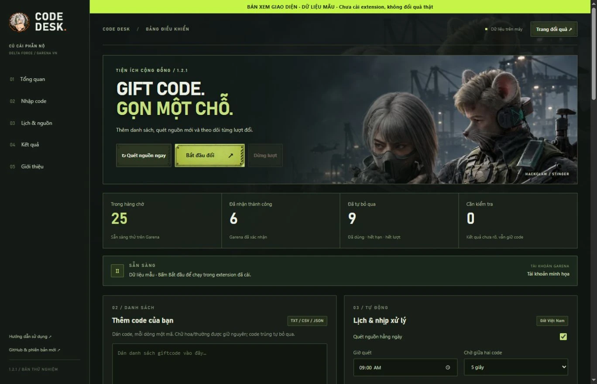
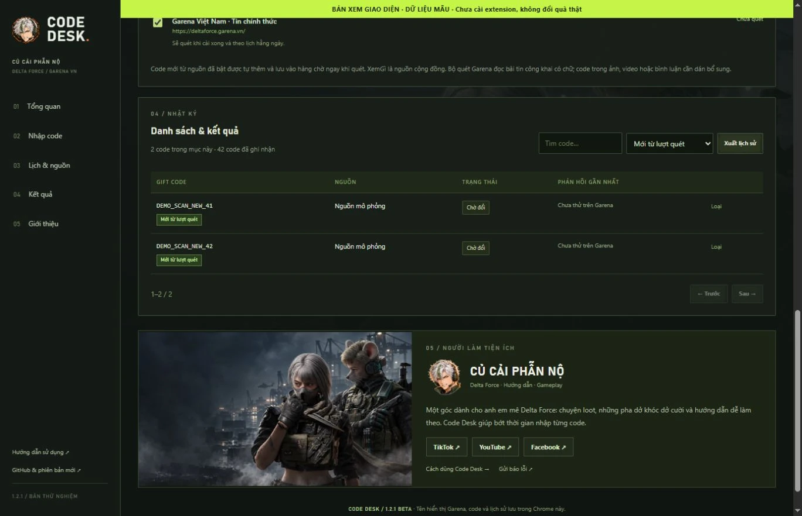
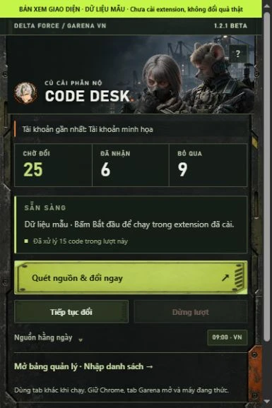
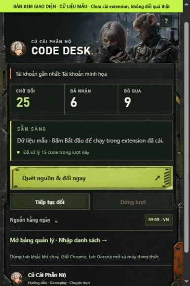
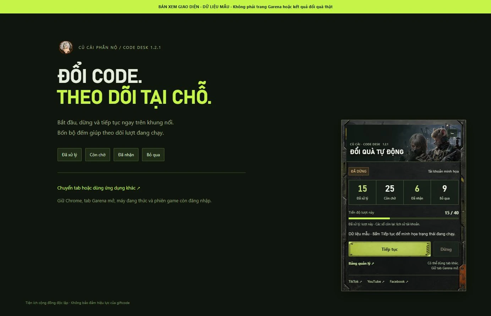

# CỦ CẢI · CODE DESK

**Bớt nhập code. Thêm giờ vào trận.**

Tiện ích Chrome trên **máy tính** giúp quản lý và tự nhập giftcode trên trang đổi quà Garena Delta Force Việt Nam.

**Bản thử nghiệm 1.2.1 · Miễn phí · Cài từ thư mục.** Chưa phát hành trên Chrome Web Store.

Repo này chứa **website giới thiệu, hướng dẫn và chính sách quyền riêng tư**. [Mã nguồn tiện ích và báo lỗi →](https://github.com/LightHaru/garena-code-desk)

## Tải về

**[Tải Garena-Code-Desk-v1.2.1.zip](https://github.com/LightHaru/garena-code-desk/releases/download/v1.2.1/Garena-Code-Desk-v1.2.1.zip)**

[Tất cả phiên bản](https://github.com/LightHaru/garena-code-desk/releases) · [Website](https://lightharu.github.io/garena-code-desk-site/) · [Quyền riêng tư](https://lightharu.github.io/garena-code-desk-site/privacy.html) · [Báo lỗi](https://github.com/LightHaru/garena-code-desk/issues)

Trong phần Assets của bản phát hành, chọn **Garena-Code-Desk-v1.2.1.zip** để tải gói tiện ích và hướng dẫn gọn sẵn. "Source code" là bản chụp toàn repository do GitHub tự tạo. Mã tiện ích hiện nằm trong thư mục [`extension/`](https://github.com/LightHaru/garena-code-desk/tree/main/extension).

## Bản 1.2.1 có gì mới?

| Khu vực | Thay đổi |
|---|---|
| Nút không mất khi rê chuột | Giữ ảnh nền và chữ rõ ở trạng thái hover; nút Chọn file hiển thị gọn |
| Quét và tự thêm | Code mới tự lưu vào hàng chờ, báo rõ số đã thêm; không cần dán hoặc bấm nhập lại |
| Xem code mới | Nút **Xem code mới**, bộ lọc **Mới từ lượt quét** và nhãn trên từng mã; mã mới lên đầu danh sách |
| Delta Force | Hackclaw, Vyron, D-Wolf skin Subrosa và **Stinger chế thành chuột quân y**, giữ tóc, tai nghe và trang phục để nhận ra đặc vụ |
| Popup | Khung máy cố định theo cửa sổ, còn nguyên khi cuộn tới cuối; sửa thanh cuộn ngang thừa |
| Nút & bảng quản lý | Bề mặt nút quân dụng và khung tạo bằng ImageGen; chữ, bộ đếm và thao tác là HTML thật |
| Khung trên Garena | Hình mới, Bắt đầu / Dừng / Tiếp tục, bốn bộ đếm và tiến độ tại chỗ |
| Nguồn code | Gợi ý điền sẵn **Code Mới, FPT Shop, Điện máy XANH**; cấp quyền cho tên miền người dùng chọn |
| Nhập nhanh | Nút **Dán 2 mã tìm thêm · 18/10** điền hai ứng viên vào ô để bạn xem rồi thêm vào hàng chờ |
| Website & hướng dẫn | Nền bốn đặc vụ xuyên suốt trang, ảnh giao diện mới, báo cáo nguồn và ba kênh Củ Cải |

Artwork minh họa cộng đồng được tạo bằng ImageGen theo ảnh nhân vật tham khảo. Avatar và icon riêng của Củ Cải giữ đúng nhận diện kênh.

Giữ bản vá CSP từ 1.1.2: tạm bỏ URL javascript của nút Đổi/Đóng trong lúc click rồi khôi phục; không nới CSP. Chưa xác nhận bản vá trong môi trường content script cô lập của Chrome đã cài.

## Xem giao diện

Ảnh chụp từ **mã giao diện thật với dữ liệu mẫu**, chưa phải ảnh xác nhận đã cài hoặc đổi quà trên tài khoản Garena thật.

 

**[Hướng dẫn có ảnh →](https://lightharu.github.io/garena-code-desk-site/guide.html)**

## Cài vào Google Chrome

1. Giải nén file ZIP vào thư mục cố định.
2. Mở `chrome://extensions` trong Chrome 116 trở lên.
3. Bật **Chế độ dành cho nhà phát triển / Developer mode**.
4. Bấm **Tải tiện ích đã giải nén / Load unpacked**.
5. Chọn thư mục **extension** chứa `manifest.json` vừa giải nén.
6. Ghim tiện ích từ biểu tượng mảnh ghép. Giữ nguyên thư mục này sau khi cài.

## Bắt đầu đổi code

Mở [trang đổi quà Garena](https://redeem.df.garena.sg/vi/cdkgarena.html), đăng nhập tài khoản game, kiểm tra đúng tài khoản rồi bấm **Bắt đầu** trên khung nổi. Có nút **Dừng / Tiếp tục**, bốn bộ đếm và thanh tiến độ ngay tại đó.

Bạn có thể dùng tab khác hoặc ứng dụng khác khi đang chạy. Giữ Chrome và tab Garena mở, máy đang thức. Đăng nhập Google Chrome không thay cho đăng nhập tài khoản game tại Garena.

**Quét nguồn ngay tự lưu code chưa có vào hàng chờ**. Sau lượt quét, xem dòng **Đã tự thêm N code mới vào hàng chờ** và nút **Xem code mới**. Mã trùng không nhân đôi; kết quả cũ và code đã loại được giữ nguyên. Quét nguồn không yêu cầu bấm Thêm vào hàng chờ lần nữa.

Trong popup có **Quét nguồn & đổi ngay**. Bảng quản lý hỗ trợ nhập TXT/CSV/JSON, thêm nguồn HTTPS, lịch quét và xuất lịch sử. Quét nguồn hằng ngày mặc định 09:00 theo giờ Việt Nam; tự đổi sau lịch quét là tùy chọn riêng, mặc định tắt.

## Tìm thêm nguồn code

Khảo sát ngày **18/10/2026**: đọc thêm tám trang ngoài XemGì. So với 242 chuỗi ứng viên từ lần quét XemGì, có sáu chuỗi mới; chỉ ưu tiên hai mã dưới đây vì xuất hiện trên nhiều trang phù hợp hơn. Nhiều trang có thể sao chép cùng danh sách.

- **WELCOMETODF** — thấy trên 5 trang.
- **DFVNA4T8Z6P3** — thấy trên 3 trang.

**Chưa xác nhận hai mã còn đổi được.** Kết quả và điều kiện nhận quà do Garena quyết định.

Trong bảng quản lý → **+ Thêm nguồn** → **Chọn nguồn đã khảo sát**, có ba cấu hình điền sẵn:

| Nguồn | Ứng viên đọc được trong lần khảo sát |
|---|---:|
| [Code Mới](https://codemoi.net/games/delta-force/) | 20 |
| [FPT Shop](https://fptshop.com.vn/tin-tuc/danh-gia/code-delta-force-184570) | 11 |
| [Điện máy XANH](https://www.dienmayxanh.com/kinh-nghiem-hay/code-delta-force-garena-moi-nhat-1591472) | 19 |

Chọn nguồn để điền URL và vùng chứa code, rồi bấm **Cấp quyền & thêm nguồn**. Sau khi được cấp quyền, nguồn dùng lịch quét hiện có. Số mã có thể thay đổi; XemGì và tin Garena vẫn là hai nguồn mặc định.

[Báo cáo đủ tám nguồn](https://lightharu.github.io/garena-code-desk-site/assets/nguon-giftcode-20261018.md) · [Danh sách hai mã TXT](https://lightharu.github.io/garena-code-desk-site/assets/code-uu-tien-20261018.txt)

Nguồn chính thức: [Garena Việt Nam](https://deltaforce.garena.vn/), [YouTube GarenaDeltaForceVN](https://www.youtube.com/@GarenaDeltaForceVN), [TikTok garenadeltaforcevn](https://www.tiktok.com/@garenadeltaforcevn). Bộ quét hiện đọc chữ công khai; chưa đọc bình luận, ảnh, livestream hoặc nhóm riêng tư.
## Theo dõi kết quả

- Nhớ code đã nhận/đã dùng theo tên hiển thị tài khoản.
- Code hết hạn, không hợp lệ hoặc hết lượt được loại khỏi hàng chờ và giữ dấu lịch sử để không tự nhập lại.
- Lỗi cấu hình gói quà hoãn code đó ít nhất 24 giờ để tiếp tục code khác.
- Lỗi mạng, xác minh hoặc kết quả chưa rõ có thể dừng lượt và giữ code để kiểm tra.

Code tìm thấy là ứng viên; quyền nhận quà và hiệu lực do Garena quyết định. Bộ quét đọc nguồn chữ công khai XemGì và một số bài tin Garena, không bao phủ bình luận, ảnh, livestream hoặc nhóm riêng tư. Lịch sử dùng tên hiển thị; tài khoản trùng tên nên dùng hồ sơ Chrome riêng.

## Cập nhật

Bản cài từ thư mục cần cập nhật thủ công. Dừng lượt và đợi kết quả đang gửi; tải ZIP mới, chép nội dung `extension` vào đúng thư mục cũ, bấm **Tải lại** tiện ích trong `chrome://extensions` và kiểm tra số **1.2.1**, rồi tải lại trang Garena. Giữ đường dẫn thư mục đã nạp để tiếp tục dùng dữ liệu của bản cài đó. Mục Lỗi của Chrome có thể còn giữ báo cáo cũ; xóa các báo cáo đó rồi bắt đầu một lượt mới để kiểm tra lỗi có tái xuất hiện hay không.

## Tình trạng bản thử nghiệm

Đã đạt **44/44 kiểm tra logic**, **37/37 kiểm tra trình duyệt mô phỏng** và **3/3 cấu hình nguồn** bằng DOMParser thật trên HTML công khai đã lưu. Đã kiểm tra hover trên nút thật của giao diện mẫu, mô phỏng quét thêm 2 mã làm hàng chờ tăng 25 → 27, quét lại không nhân đôi; đã xem popup 400 × 600 ở đầu/cuối và bố cục hẹp. Chưa xác nhận bản 1.2.1 trong môi trường content script cô lập trên Chrome đã cài, đổi quà trên tài khoản Garena thật hoặc chạy lịch qua một ngày thật. Trang Garena thay đổi có thể cần cập nhật tiện ích. Máy ngủ, Chrome đóng, tab đóng/treo, phiên hết hạn hoặc xác minh sẽ ảnh hưởng lượt chạy.

Gửi báo lỗi tại [Issues](https://github.com/LightHaru/garena-code-desk/issues) kèm phiên bản và thông báo. Không đưa mật khẩu, cookie, OTP, token hoặc thông tin riêng vào báo lỗi công khai.

## Quyền riêng tư

Tên hiển thị, code và lịch sử được lưu trong hồ sơ Chrome đang cài. Không có máy chủ nhận lịch sử, quảng cáo hay công cụ phân tích hành vi trong tiện ích. Xem [chính sách đầy đủ và các quyền sử dụng](https://lightharu.github.io/garena-code-desk-site/privacy.html).

## Củ Cải Phẫn Nộ

Hướng dẫn dễ làm theo, chuyện loot và những pha Delta Force dở khóc dở cười. Code Desk là một tiện ích nhỏ để anh em bớt ngồi nhập từng code.

| TikTok | YouTube | Facebook |
|---|---|---|
| [@cucaiphannodf ↗](https://www.tiktok.com/@cucaiphannodf) | [@CucaiDF ↗](https://www.youtube.com/@CucaiDF) | [Cucaiphanno ↗](https://www.facebook.com/profile.php?id=61594886253423) |

Tiện ích cộng đồng độc lập của **Củ Cải Phẫn Nộ**, không phải sản phẩm chính thức hoặc được Garena/Google bảo trợ. Các nhãn hiệu thuộc chủ sở hữu tương ứng.
