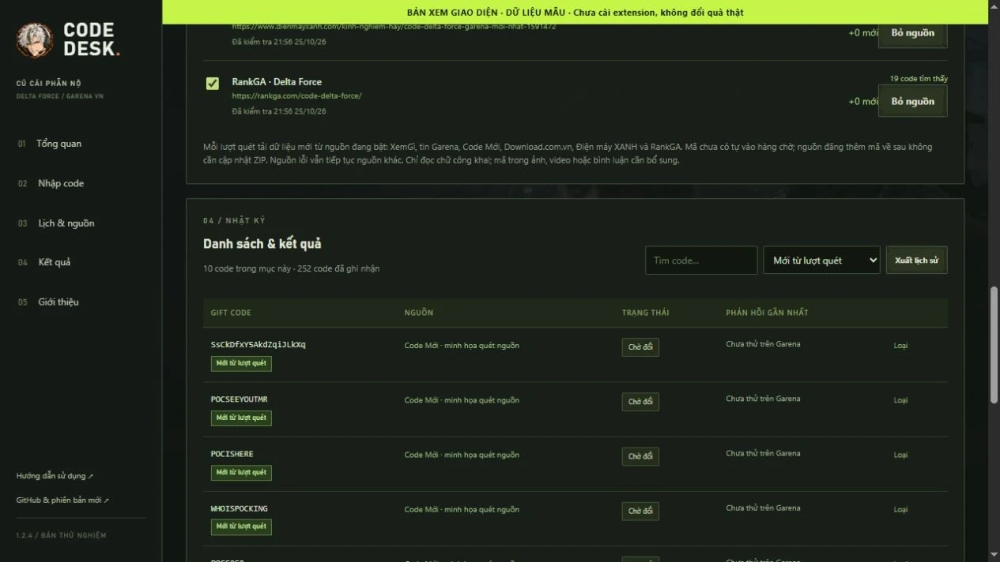
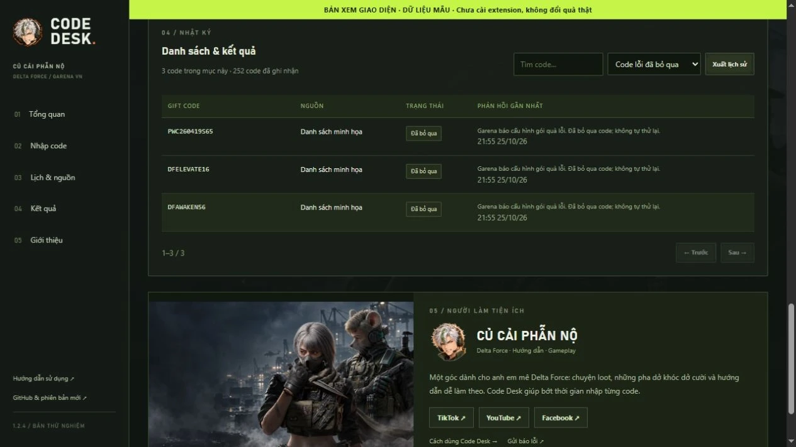
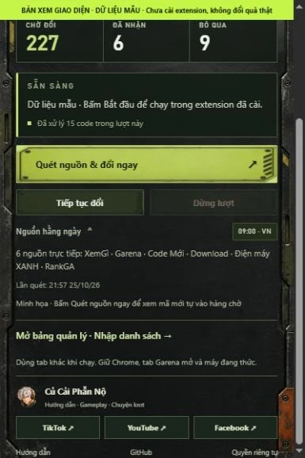

# CỦ CẢI · CODE DESK

**Bớt nhập code. Thêm giờ vào trận.**

Tiện ích Chrome trên **máy tính** để quét nguồn và tự nhập giftcode trên trang đổi quà Garena Delta Force Việt Nam.

**Bản thử nghiệm 1.2.4 · Miễn phí · Cài từ thư mục.** Chưa phát hành trên Chrome Web Store.

Repo này chứa **website giới thiệu, hướng dẫn và chính sách quyền riêng tư**. [Mã nguồn tiện ích và báo lỗi →](https://github.com/LightHaru/garena-code-desk)

## Tải về

**[Tải Garena-Code-Desk-v1.2.4.zip](https://github.com/LightHaru/garena-code-desk/releases/download/v1.2.4/Garena-Code-Desk-v1.2.4.zip)**

[Tất cả phiên bản](https://github.com/LightHaru/garena-code-desk/releases) · [Website](https://lightharu.github.io/garena-code-desk-site/) · [Quyền riêng tư](https://lightharu.github.io/garena-code-desk-site/privacy.html) · [Báo lỗi](https://github.com/LightHaru/garena-code-desk/issues)

Trong Assets, chọn đúng ZIP theo tên trên. “Source code” là bản chụp repository do GitHub tạo; mã tiện ích nằm trong [`extension/`](https://github.com/LightHaru/garena-code-desk/tree/main/extension).

## Mã đăng sau ngày cài có tự lấy được không?

**Có, khi mã xuất hiện dưới dạng chữ trên nguồn đang bật và bộ đọc nhận dạng được.** Mỗi lần bấm **Quét nguồn ngay**, tiện ích tải dữ liệu hiện tại, giữ đúng chữ hoa/thường, đối chiếu lịch sử rồi tự lưu mã chưa có vào hàng chờ. Không cần sửa danh sách kèm bản cài, dán lại mã hoặc tải ZIP cho mỗi đợt code mới.

Lịch **09:00 giờ Việt Nam** dùng cùng bộ quét. Chrome cần đang mở, máy đang thức; tự đổi sau lịch quét là tùy chọn riêng, mặc định tắt. Bật **Quét xong, tự mở Garena và đổi code mới** nếu muốn lịch quét mở lượt đổi khi phiên Garena còn hợp lệ.

Sau lượt quét, xem **Đã tự thêm N code mới vào hàng chờ → Xem code mới**. Nếu nguồn chưa đăng thêm hoặc chỉ có mã đã xử lý, số mới bằng 0. Nguồn lỗi báo riêng; mã từ nguồn đọc được vẫn được lưu.

## Bản 1.2.4 thay đổi gì?

| Phần | Thay đổi |
|---|---|
| 6 nguồn mặc định | XemGì, Garena, Code Mới, Download.com.vn, Điện máy XANH và RankGA được quét trực tiếp |
| Dự phòng bật sẵn | Cập nhật tự thêm ba nguồn dự phòng chưa có; nguồn từng tự tắt vẫn giữ tắt; không thêm trùng |
| Đọc HTML | Kết hợp thẻ code, bảng đúng cột và nhãn giftcode ở nguồn mặc định; mã nằm ngoài selector cũ vẫn được đọc |
| Tin Garena | Đọc tin chung, sự kiện và giải đấu; tối đa 12 bài/lượt, ưu tiên bài về code; một bài lỗi không làm mất mã từ bài khác |
| Dữ liệu XemGì | Theo import khi chunk dữ liệu đổi tên, chỉ đọc văn bản; không chạy JavaScript của nguồn |
| Tiến trình | Hiện nguồn đang quét và số mã vừa thêm; phân biệt lỗi với “không có mã mới” |
| Lịch sử | Không nhân đôi hoặc tự đưa code đã nhận, đã dùng, hết hạn hay báo lỗi trở lại hàng chờ |

Bản này thêm quyền đọc **`download.com.vn`**, **`www.dienmayxanh.com`**, **`rankga.com`** cho ba nguồn dự phòng. Nguồn HTTPS tự thêm ở tên miền khác xin quyền riêng khi bạn bấm thêm.

## Nguồn quét trực tiếp

| Nguồn mặc định | Dữ liệu |
|---|---|
| [XemGì](https://xemgi.de/codes) | API và danh sách Delta Force công khai |
| [Garena Việt Nam](https://deltaforce.garena.vn/) | Chữ trong bài tin, sự kiện và giải đấu mới |
| [Code Mới](https://codemoi.net/games/delta-force/) | Thẻ code, bảng và nhãn giftcode |
| [Download.com.vn](https://download.com.vn/code-game-delta-force-195638) | Danh sách giftcode trong bài |
| [Điện máy XANH](https://www.dienmayxanh.com/kinh-nghiem-hay/code-delta-force-garena-moi-nhat-1591472) | Danh sách giftcode trong bài |
| [RankGA](https://rankga.com/code-delta-force/) | Danh sách giftcode trong bài |

Trong **Nguồn lấy code**, kiểm tra từng nguồn đang bật và phản hồi lượt gần nhất. Có thể tắt nguồn không muốn dùng; **+ Thêm nguồn** cho thêm TXT/CSV/JSON hoặc HTML công khai khác. Nguồn đã bỏ sau khi cập nhật sẽ không tự xuất hiện lại ở lần khởi động sau.

Bộ quét đọc **chữ công khai ở các nguồn đã cấu hình**, chưa đọc ảnh, video, livestream, bình luận hay nhóm riêng. Nguồn có thể chưa đăng mã, chặn truy cập hoặc đổi cấu trúc ngoài khả năng bộ đọc; xem lỗi nguồn để biết phạm vi lượt quét. Mã tìm thấy là ứng viên; hiệu lực và điều kiện tài khoản do Garena xác nhận.

## Xem giao diện

Ảnh từ **mã giao diện 1.2.4 với dữ liệu mẫu**, chưa phải xác nhận đã cài hoặc đổi quà trên tài khoản thật.

 

**[Hướng dẫn có ảnh →](https://lightharu.github.io/garena-code-desk-site/guide.html)**

## Cài và bắt đầu

1. Giải nén ZIP vào thư mục cố định.
2. Mở `chrome://extensions` trên Chrome 116 trở lên, bật **Developer mode**.
3. Bấm **Load unpacked / Tải tiện ích đã giải nén**, chọn thư mục **extension** chứa `manifest.json`.
4. Ghim tiện ích; giữ nguyên thư mục đã nạp.
5. Mở [trang đổi quà Garena](https://redeem.df.garena.sg/vi/cdkgarena.html), đăng nhập tài khoản game và kiểm tra đúng tài khoản.
6. Bấm **Quét nguồn & đổi ngay** trong popup, hoặc **Quét nguồn ngay → Bắt đầu đổi** trong bảng quản lý.

Khung nổi có **Bắt đầu / Dừng / Tiếp tục**, bốn bộ đếm và thanh tiến độ. Có thể dùng tab hoặc ứng dụng khác; giữ Chrome và tab Garena mở, máy đang thức. Đăng nhập Google Chrome không thay cho phiên tài khoản game trên Garena.

### Theo dõi kết quả

- Lưu code đã nhận/đã dùng theo tên hiển thị tài khoản.
- Code hết hạn, không hợp lệ, hết lượt hoặc báo lỗi được bỏ qua; không tự thử lại sau 24 giờ.
- Lỗi gói quà 400073 bỏ qua code đó và tiếp tục code khác.
- Đăng nhập, CAPTCHA, giới hạn tốc độ hoặc mất kết nối: bỏ qua code vừa gửi và tạm dừng; xử lý trên Garena rồi tiếp tục mã chưa gửi. Với HTTP 429, chờ ít nhất 15 phút.

## Cập nhật phần mềm

1. Bấm **Dừng**, đợi code đang gửi có kết quả.
2. Tải ZIP 1.2.4, chép nội dung `extension` vào **đúng thư mục cũ**.
3. Trong `chrome://extensions`, bấm **Tải lại**; kiểm tra số **1.2.4**. Nếu Chrome hỏi quyền, kiểm tra ba tên miền nguồn dự phòng nêu trên.
4. Tải lại trang Garena, bấm **Quét nguồn ngay → Xem code mới**.

Giữ đường dẫn thư mục cũ để tiếp tục dữ liệu hiện có. Bản cài từ thư mục cập nhật phần mềm bằng ZIP; **mã mới trên nguồn đang bật được tải trực tiếp mỗi lần quét**.

## Kiểm tra bản thử nghiệm

**58/58 Node, 51/51 trình duyệt mô phỏng và 6/6 nguồn qua DOMParser PASS.** Kiểm tra đã đổi nội dung nguồn sau lượt đầu, thêm mã chưa có trong seed, đổi thẻ code sang bảng/cột khác, rồi xác nhận quét tay và lịch hằng ngày tự lưu mã mới, không tăng trùng và giữ lịch sử cũ.

HTTP của sáu nguồn được tải lại ngày 25/10/2026. Đây là kiểm tra truy cập và trích danh sách, chưa xác nhận hiệu lực code. Cài bản này dưới content script cô lập, đổi quà tài khoản thật và lịch chạy đủ một ngày: **NOT_RUN**.

## Quyền riêng tư và hỗ trợ

Tên hiển thị, code, cài đặt và lịch sử lưu trong hồ sơ Chrome. Không có máy chủ nhận lịch sử, quảng cáo hay phân tích hành vi. Yêu cầu tải nguồn không đính kèm cookie hoặc tên tài khoản. Tài khoản trùng tên nên dùng hồ sơ Chrome riêng.

[Chính sách](https://lightharu.github.io/garena-code-desk-site/privacy.html) · [GitHub Issues](https://github.com/LightHaru/garena-code-desk/issues). Chỉ gửi phiên bản và thông báo cần thiết, tránh mật khẩu, cookie, OTP, token và lịch sử riêng.

## Củ Cải Phẫn Nộ

Hướng dẫn dễ làm theo, chuyện loot và những pha Delta Force dở khóc dở cười.

| TikTok | YouTube | Facebook |
|---|---|---|
| [@cucaiphannodf ↗](https://www.tiktok.com/@cucaiphannodf) | [@CucaiDF ↗](https://www.youtube.com/@CucaiDF) | [Cucaiphanno ↗](https://www.facebook.com/profile.php?id=61594886253423) |

Artwork cộng đồng tạo bằng ImageGen theo ảnh tham khảo. Tiện ích độc lập của **Củ Cải Phẫn Nộ**, không phải sản phẩm chính thức hoặc được Garena/Google bảo trợ. Nhãn hiệu thuộc chủ sở hữu tương ứng.
