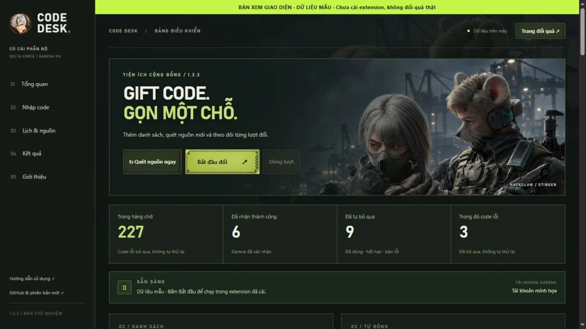
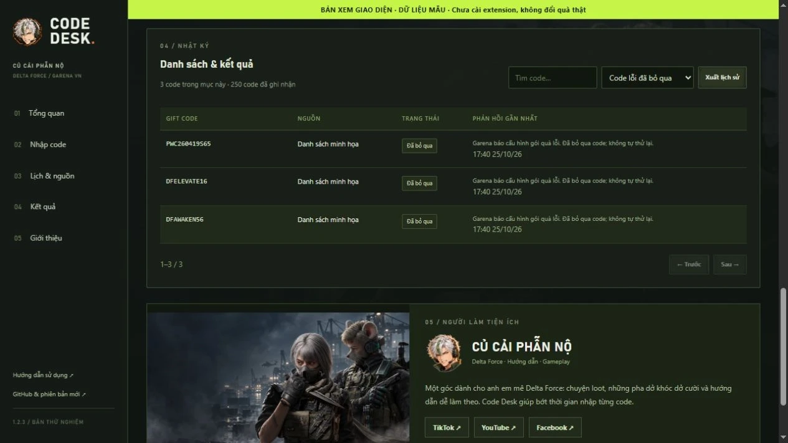
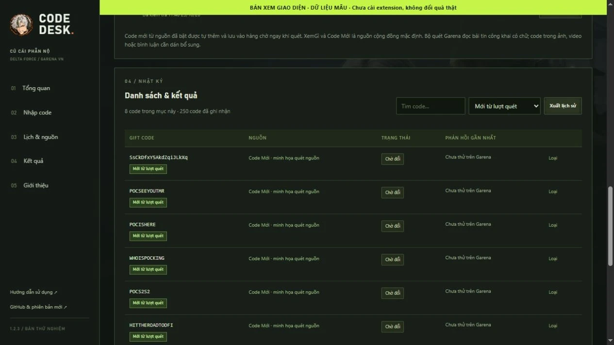
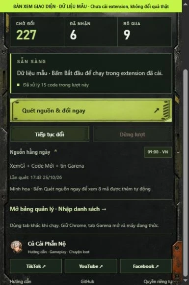
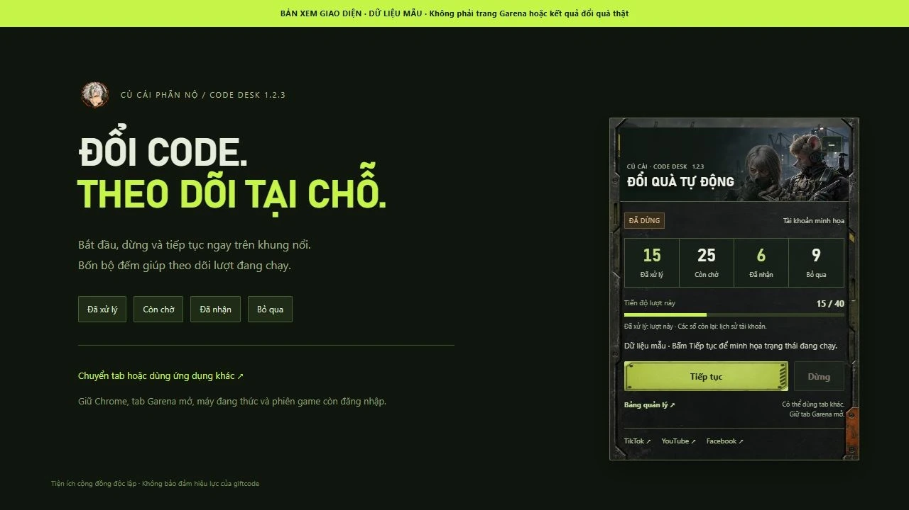

<p></p>

# CỦ CẢI · CODE DESK

**Bớt nhập code. Thêm giờ vào trận.**


Tiện ích Chrome trên **máy tính** giúp quản lý và tự nhập giftcode trên trang đổi quà Garena Delta Force Việt Nam.

**Bản thử nghiệm 1.2.3 · Miễn phí · Cài từ thư mục.** Chưa phát hành trên Chrome Web Store.

Repo này chứa **website giới thiệu, hướng dẫn và chính sách quyền riêng tư**. [Mã nguồn tiện ích và báo lỗi →](https://github.com/LightHaru/garena-code-desk)

## Tải về

**[Tải Garena-Code-Desk-v1.2.3.zip](https://github.com/LightHaru/garena-code-desk/releases/download/v1.2.3/Garena-Code-Desk-v1.2.3.zip)**

[Tất cả phiên bản](https://github.com/LightHaru/garena-code-desk/releases) · [Website](https://lightharu.github.io/garena-code-desk-site/) · [Quyền riêng tư](https://lightharu.github.io/garena-code-desk-site/privacy.html) · [Báo lỗi](https://github.com/LightHaru/garena-code-desk/issues)

Trong phần Assets của bản phát hành, chọn **Garena-Code-Desk-v1.2.3.zip** để tải gói tiện ích và hướng dẫn gọn sẵn. "Source code" là bản chụp toàn repository do GitHub tự tạo. Mã tiện ích hiện nằm trong thư mục [`extension/`](https://github.com/LightHaru/garena-code-desk/tree/main/extension).

## Bản 1.2.3 có gì mới?

| Khu vực | Thay đổi |
|---|---|
| Quét thêm mã mới | **Code Mới được thêm mặc định**, bên cạnh XemGì và tin Garena; bản cài cũ tự nhận nguồn mới khi cập nhật |
| Giữ lựa chọn của bạn | Không thêm trùng nguồn đã có; nguồn Code Mới từng tự thêm và tắt vẫn giữ tắt |
| Tự lưu vào hàng chờ | Quét ngày 25/10 phát hiện **8 ứng viên chưa có trong 242 mã XemGì**, gộp 250 mã; quét lại không tăng trùng |
| Trạng thái nguồn rõ hơn | Phân biệt không có mã mới với nguồn lỗi/đọc một phần; lượt bị gián đoạn không khóa nút quét mãi |
| Đọc đúng danh sách | Giữ chữ hoa/thường, nhận mã không bắt đầu bằng DF; không nhập tiêu đề “Codes” thành giftcode |
| Nguồn gợi ý | Thay link FPT Shop trả 404 bằng **Download.com.vn**; giữ Điện máy XANH và cấu hình HTML tùy chọn |
| Lịch sử xử lý | Code đã nhận/đã dùng/đã bỏ qua giữ nguyên; code lỗi không được tự gửi lại |
| Giao diện & hướng dẫn | Giữ artwork Delta Force, khung nổi, nút điều khiển và ba kênh Củ Cải; ảnh hướng dẫn chụp lại từ 1.2.3 |

Bản 1.2.3 thêm quyền đọc **`https://codemoi.net/*`** để quét Code Mới. Các nguồn tùy chọn khác vẫn xin quyền theo tên miền khi bạn thêm.

Artwork minh họa cộng đồng được tạo bằng ImageGen theo ảnh nhân vật tham khảo. Avatar và icon riêng của Củ Cải giữ đúng nhận diện kênh.

Giữ bản vá CSP từ 1.1.2: tạm bỏ URL javascript của nút Đổi/Đóng trong lúc click rồi khôi phục; không nới CSP. Chưa xác nhận bản vá trong môi trường content script cô lập của Chrome đã cài.

## Xem giao diện

Ảnh chụp từ **mã giao diện thật với dữ liệu mẫu**, chưa phải ảnh xác nhận đã cài hoặc đổi quà trên tài khoản Garena thật.







<p> </p>



**[Hướng dẫn có ảnh →](https://lightharu.github.io/garena-code-desk-site/guide.html)**

## Cài vào Google Chrome

1. Giải nén file ZIP vào thư mục cố định.
2. Mở `chrome://extensions` trong Chrome 116 trở lên.
3. Bật **Chế độ dành cho nhà phát triển / Developer mode**.
4. Bấm **Tải tiện ích đã giải nén / Load unpacked**.
5. Chọn thư mục **extension** chứa `manifest.json` vừa giải nén.
6. Ghim tiện ích từ biểu tượng mảnh ghép. Giữ nguyên thư mục này sau khi cài.

## Bắt đầu đổi code

Mở [trang đổi quà Garena](https://redeem.df.garena.sg/vi/cdkgarena.html), đăng nhập tài khoản game, kiểm tra đúng tài khoản rồi bấm **Bắt đầu** trên khung nổi. Có nút **Dừng / Tiếp tục**, bốn bộ đếm và thanh tiến độ ngay tại đó.

Bạn có thể dùng tab khác hoặc ứng dụng khác khi đang chạy. Giữ Chrome và tab Garena mở, máy đang thức. Đăng nhập Google Chrome không thay cho đăng nhập tài khoản game tại Garena.

**Quét nguồn ngay tự lưu code chưa có vào hàng chờ**. Sau lượt quét, xem dòng **Đã tự thêm N code mới vào hàng chờ** và nút **Xem code mới**. Mã trùng không nhân đôi; kết quả cũ và code đã loại được giữ nguyên. Quét nguồn không yêu cầu bấm Thêm vào hàng chờ lần nữa.

Trong popup có **Quét nguồn & đổi ngay**. Bảng quản lý hỗ trợ nhập TXT/CSV/JSON, thêm nguồn HTTPS, lịch quét và xuất lịch sử. Quét nguồn hằng ngày mặc định 09:00 theo giờ Việt Nam; tự đổi sau lịch quét là tùy chọn riêng, mặc định tắt.

## Nguồn quét và những mã bị bỏ sót

Đối chiếu nguồn công khai ngày **25/10/2026**: XemGì vẫn có 242 ứng viên, Code Mới đọc được 41 mã. Hợp hai nguồn là **250 ứng viên**, gồm 8 mã chưa có trong danh sách XemGì:

```text
SsCkDfxY5AkdZqiJLkXq
POCSEEYOUTMR
POCISHERE
WHOISPOCKING
POCS2S2
HITTHEROADTODFI
DFVNA4T8Z6P3
WELCOMETODF
```

Đây là mã xuất hiện trong nguồn, **chưa xác nhận còn hạn hoặc đổi được**. Garena xác nhận kết quả khi bạn đổi.

**Nguồn mặc định:** [XemGì](https://xemgi.de/codes), [tin Garena Việt Nam](https://deltaforce.garena.vn/) và [Code Mới](https://codemoi.net/games/delta-force/). Bản cài cũ tự được thêm Code Mới sau khi cập nhật 1.2.3, trừ khi đã có nguồn này; trạng thái bật/tắt sẵn có được giữ nguyên.

Trong bảng quản lý → **+ Thêm nguồn**, có cấu hình điền sẵn:

| Nguồn | Ứng viên đọc được ngày 25/10 | Cách dùng |
|---|---:|---|
| [Code Mới](https://codemoi.net/games/delta-force/) | 41 | Đã có mặc định; kiểm tra nguồn đang bật |
| [Download.com.vn](https://download.com.vn/code-game-delta-force-195638) | 24 | Chọn rồi bấm Cấp quyền & thêm nguồn |
| [Điện máy XANH](https://www.dienmayxanh.com/kinh-nghiem-hay/code-delta-force-garena-moi-nhat-1591472) | 19 | Chọn rồi bấm Cấp quyền & thêm nguồn |

Các danh sách có nhiều mã trùng và mã cũ. Không cộng các cột thành số code mới. Gợi ý FPT Shop đã được thay vì link hiện trả HTTP 404; nguồn FPT bạn tự thêm trước đây có thể tắt trong bảng quản lý.

[Báo cáo nguồn 25/10](https://lightharu.github.io/garena-code-desk-site/assets/nguon-giftcode-20261025.md) · [Danh sách 8 mã TXT](https://lightharu.github.io/garena-code-desk-site/assets/code-uu-tien-20261025.txt)

Nguồn chính thức: [Garena Việt Nam](https://deltaforce.garena.vn/), [YouTube GarenaDeltaForceVN](https://www.youtube.com/@GarenaDeltaForceVN), [TikTok garenadeltaforcevn](https://www.tiktok.com/@garenadeltaforcevn). Bộ quét hiện đọc chữ công khai; chưa đọc bình luận, ảnh, livestream hoặc nhóm riêng tư.

## Theo dõi kết quả

- Nhớ code đã nhận/đã dùng theo tên hiển thị tài khoản.
- Code hết hạn, không hợp lệ hoặc hết lượt được loại khỏi hàng chờ và giữ dấu lịch sử để không tự nhập lại.
- Code lỗi, kể cả cấu hình gói quà 400073, được bỏ qua luôn và tiếp tục các code khác; không hẹn thử lại.
- Lỗi mạng, đăng nhập, xác minh hoặc mất phản hồi: bỏ qua code đã gửi và tạm dừng lượt; xử lý trên Garena rồi tiếp tục các code còn lại. Với HTTP 429, chờ ít nhất 15 phút.

Code tìm thấy là ứng viên; quyền nhận quà và hiệu lực do Garena quyết định. Bộ quét đọc nguồn chữ công khai XemGì, Code Mới và một số bài tin Garena, không bao phủ bình luận, ảnh, livestream hoặc nhóm riêng tư. Lịch sử dùng tên hiển thị; tài khoản trùng tên nên dùng hồ sơ Chrome riêng.

## Cập nhật

Bản cài từ thư mục cần cập nhật thủ công. Dừng lượt và đợi kết quả đang gửi; tải ZIP mới, chép nội dung `extension` vào đúng thư mục cũ, bấm **Tải lại** tiện ích trong `chrome://extensions` và kiểm tra số **1.2.3**, rồi tải lại trang Garena. Nếu Chrome hỏi quyền mới, kiểm tra đúng `codemoi.net` để cho phép quét nguồn này. Bấm **Quét nguồn ngay**, sau đó **Xem code mới**. Giữ đường dẫn thư mục đã nạp để tiếp tục dùng dữ liệu của bản cài đó. Mục Lỗi của Chrome có thể còn giữ báo cáo cũ; xóa các báo cáo đó rồi bắt đầu một lượt mới để kiểm tra lỗi có tái xuất hiện hay không.

## Tình trạng bản thử nghiệm

Đã đạt **53/53 kiểm tra logic**, **44/44 kiểm tra trình duyệt mô phỏng** và **3/3 cấu hình nguồn** bằng DOMParser thật trên HTML công khai đã lưu ngày 25/10. Luồng quét chạy bằng mã thật của tiện ích đã tự lưu 8 mã còn thiếu, tăng 242 → 250, giữ lịch sử code lỗi/đã nhận và không thêm trùng ở lượt sau. Ảnh giao diện 1.2.3 dùng dữ liệu mẫu được ghi rõ trên ảnh. Chưa xác nhận bản 1.2.3 trong môi trường content script cô lập trên Chrome đã cài, đổi quà trên tài khoản Garena thật hoặc chạy lịch qua một ngày thật. Máy ngủ, Chrome đóng, tab đóng/treo, phiên hết hạn hoặc xác minh sẽ ảnh hưởng lượt chạy.

Gửi báo lỗi tại [Issues](https://github.com/LightHaru/garena-code-desk/issues) kèm phiên bản và thông báo. Không đưa mật khẩu, cookie, OTP, token hoặc thông tin riêng vào báo lỗi công khai.

## Quyền riêng tư

Tên hiển thị, code và lịch sử được lưu trong hồ sơ Chrome đang cài. Không có máy chủ nhận lịch sử, quảng cáo hay công cụ phân tích hành vi trong tiện ích. Xem [chính sách đầy đủ và các quyền sử dụng](https://lightharu.github.io/garena-code-desk-site/privacy.html).

## Củ Cải Phẫn Nộ

<p></p>

Hướng dẫn dễ làm theo, chuyện loot và những pha Delta Force dở khóc dở cười. Code Desk là một tiện ích nhỏ để anh em bớt ngồi nhập từng code.

| TikTok | YouTube | Facebook |
|---|---|---|
| [@cucaiphannodf ↗](https://www.tiktok.com/@cucaiphannodf) | [@CucaiDF ↗](https://www.youtube.com/@CucaiDF) | [Cucaiphanno ↗](https://www.facebook.com/profile.php?id=61594886253423) |

Tiện ích cộng đồng độc lập của **Củ Cải Phẫn Nộ**, không phải sản phẩm chính thức hoặc được Garena/Google bảo trợ. Các nhãn hiệu thuộc chủ sở hữu tương ứng.
