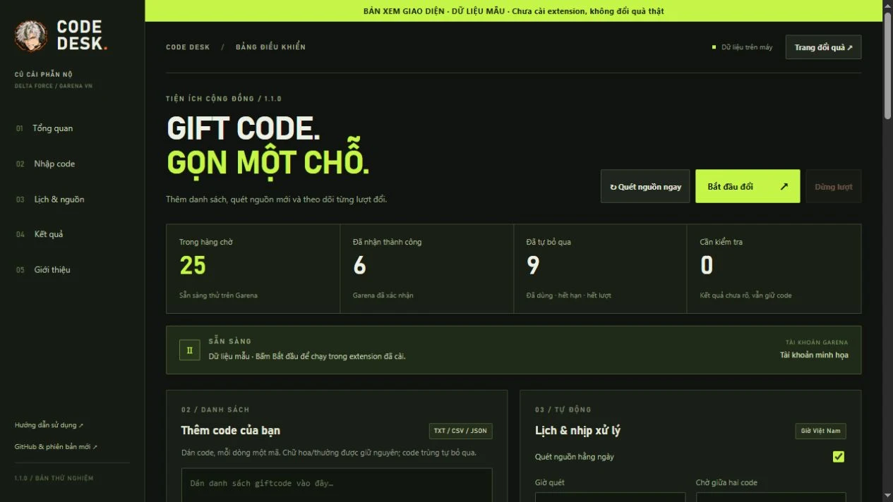
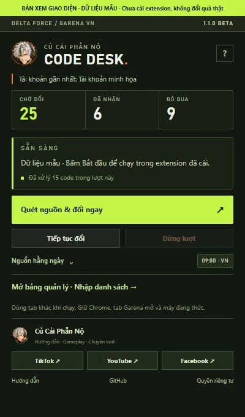
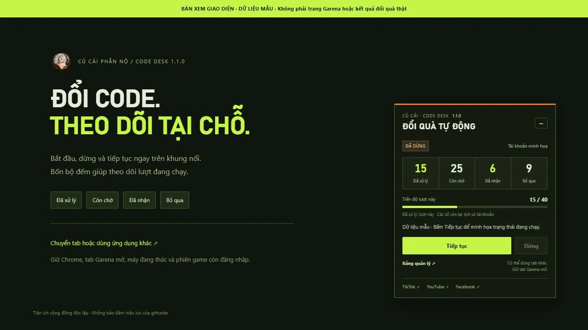

# CỦ CẢI · CODE DESK

**Bớt nhập code. Thêm giờ vào trận.**

Tiện ích Chrome trên **máy tính** giúp quản lý và tự nhập giftcode trên trang đổi quà Garena Delta Force Việt Nam.

**Bản thử nghiệm 1.1.2 · Miễn phí · Cài từ thư mục.** Chưa phát hành trên Chrome Web Store.

Repo này chứa **website giới thiệu, hướng dẫn và chính sách quyền riêng tư**. [Mã nguồn tiện ích và báo lỗi →](https://github.com/LightHaru/garena-code-desk)

## Tải về

**[Tải Garena-Code-Desk-v1.1.2.zip](https://github.com/LightHaru/garena-code-desk/releases/download/v1.1.2/Garena-Code-Desk-v1.1.2.zip)**

[Tất cả phiên bản](https://github.com/LightHaru/garena-code-desk/releases) · [Website](https://lightharu.github.io/garena-code-desk-site/) · [Quyền riêng tư](https://lightharu.github.io/garena-code-desk-site/privacy.html) · [Báo lỗi](https://github.com/LightHaru/garena-code-desk/issues)

Trong phần Assets của bản phát hành, chọn **Garena-Code-Desk-v1.1.2.zip** để tải gói tiện ích và hướng dẫn gọn sẵn. "Source code" là bản chụp toàn repository do GitHub tự tạo. Mã tiện ích hiện nằm trong thư mục [`extension/`](https://github.com/LightHaru/garena-code-desk/tree/main/extension).

## Bản vá 1.1.2

Khắc phục tiếp cảnh báo **“Running the JavaScript URL violates ... Content Security Policy”** còn được báo trên bản 1.1.1. Khi bấm Đổi hoặc Đóng, tiện ích tạm bỏ địa chỉ `javascript:void(0)` trước khi gọi click, rồi khôi phục sau đó. Handler của Garena vẫn chạy một lần. Không thêm quyền hoặc nới CSP.

Đã đạt 42/42 kiểm tra logic và 37/37 kiểm tra trình duyệt mô phỏng, gồm cả hai nút dưới CSP. Chưa xác nhận bản vá trong môi trường content script cô lập trên Chrome đã cài hoặc đổi quà tài khoản Garena thật. Giao diện và bộ nhận diện dùng thiết kế 1.1.0 dưới đây.

## Bản 1.1.0 có gì mới?

| Khu vực | Thay đổi |
|---|---|
| Nhận diện | Icon mới với nhân vật anime tóc bạc của kênh; thumbnail riêng cho Code Desk |
| Popup | Tông tác chiến, bộ đếm rõ, chi tiết nguồn thu gọn và hướng dẫn mở bằng dấu **?** |
| Bảng quản lý | Thanh điều hướng, khu nhập code, lịch, nguồn và kết quả riêng; thích ứng cửa sổ hẹp |
| Khung nổi | Nút Bắt đầu / Dừng / Tiếp tục, bốn bộ đếm và tiến độ trong giao diện mới |
| Hướng dẫn | Trang cách cài, dùng, đọc kết quả và cập nhật; ảnh giao diện có ghi dữ liệu mẫu |
| Củ Cải | Giới thiệu tác giả, dẫn về TikTok, YouTube và Facebook ngay trong tiện ích |

## Xem giao diện

Ảnh chụp từ **mã giao diện thật với dữ liệu mẫu**, chưa phải ảnh xác nhận đã cài hoặc đổi quà trên tài khoản Garena thật.

**[Hướng dẫn có ảnh →](https://lightharu.github.io/garena-code-desk-site/guide.html)**

## Cài vào Google Chrome

1. Giải nén file ZIP vào thư mục cố định.
2. Mở `chrome://extensions` trong Chrome 116 trở lên.
3. Bật **Chế độ dành cho nhà phát triển / Developer mode**.
4. Bấm **Tải tiện ích đã giải nén / Load unpacked**.
5. Chọn thư mục **extension** chứa `manifest.json` vừa giải nén.
6. Ghim tiện ích từ biểu tượng mảnh ghép. Giữ nguyên thư mục này sau khi cài.

## Bắt đầu đổi code

Mở [trang đổi quà Garena](https://redeem.df.garena.sg/vi/cdkgarena.html), đăng nhập tài khoản game, kiểm tra đúng tài khoản rồi bấm **Bắt đầu** trên khung nổi. Có nút **Dừng / Tiếp tục**, bốn bộ đếm và thanh tiến độ ngay tại đó.

Bạn có thể dùng tab khác hoặc ứng dụng khác khi đang chạy. Giữ Chrome và tab Garena mở, máy đang thức. Đăng nhập Google Chrome không thay cho đăng nhập tài khoản game tại Garena.

Trong popup có **Quét nguồn & đổi ngay**. Bảng quản lý hỗ trợ nhập TXT/CSV/JSON, thêm nguồn HTTPS, lịch quét và xuất lịch sử. Quét nguồn hằng ngày mặc định 09:00 theo giờ Việt Nam; tự đổi sau lịch quét là tùy chọn riêng, mặc định tắt.

## Theo dõi kết quả

- Nhớ code đã nhận/đã dùng theo tên hiển thị tài khoản.
- Code hết hạn, không hợp lệ hoặc hết lượt được loại khỏi hàng chờ và giữ dấu lịch sử để không tự nhập lại.
- Lỗi cấu hình gói quà hoãn code đó ít nhất 24 giờ để tiếp tục code khác.
- Lỗi mạng, xác minh hoặc kết quả chưa rõ có thể dừng lượt và giữ code để kiểm tra.

Code tìm thấy là ứng viên; quyền nhận quà và hiệu lực do Garena quyết định. Bộ quét đọc nguồn chữ công khai XemGì và một số bài tin Garena, không bao phủ bình luận, ảnh, livestream hoặc nhóm riêng tư. Lịch sử dùng tên hiển thị; tài khoản trùng tên nên dùng hồ sơ Chrome riêng.

## Cập nhật

Bản cài từ thư mục cần cập nhật thủ công. Dừng lượt và đợi kết quả đang gửi; tải ZIP mới, chép nội dung `extension` vào đúng thư mục cũ, bấm **Tải lại** tiện ích trong `chrome://extensions` và kiểm tra số **1.1.2**, rồi tải lại trang Garena. Giữ đường dẫn thư mục đã nạp để tiếp tục dùng dữ liệu của bản cài đó. Mục Lỗi của Chrome có thể còn giữ báo cáo cũ; xóa các báo cáo đó rồi bắt đầu một lượt mới để kiểm tra lỗi có tái xuất hiện hay không.

## Tình trạng bản thử nghiệm

Đã đạt **42/42 kiểm tra logic** và **37/37 kiểm tra trình duyệt giả lập**. Chưa xác nhận bản 1.1.2 trong môi trường content script cô lập trên Chrome đã cài, đổi quà trên tài khoản Garena thật hoặc chạy lịch qua một ngày thật. Trang Garena thay đổi có thể cần cập nhật tiện ích. Máy ngủ, Chrome đóng, tab đóng/treo, phiên hết hạn hoặc xác minh sẽ ảnh hưởng lượt chạy.

Gửi báo lỗi tại [Issues](https://github.com/LightHaru/garena-code-desk/issues) kèm phiên bản và thông báo. Không đưa mật khẩu, cookie, OTP, token hoặc thông tin riêng vào báo lỗi công khai.

## Quyền riêng tư

Tên hiển thị, code và lịch sử được lưu trong hồ sơ Chrome đang cài. Không có máy chủ nhận lịch sử, quảng cáo hay công cụ phân tích hành vi trong tiện ích. Xem [chính sách đầy đủ và các quyền sử dụng](https://lightharu.github.io/garena-code-desk-site/privacy.html).

## Củ Cải Phẫn Nộ

Hướng dẫn dễ làm theo, chuyện loot và những pha Delta Force dở khóc dở cười. Code Desk là một tiện ích nhỏ để anh em bớt ngồi nhập từng code.

| TikTok | YouTube | Facebook |
|---|---|---|
| [@cucaiphannodf ↗](https://www.tiktok.com/@cucaiphannodf) | [@CucaiDF ↗](https://www.youtube.com/@CucaiDF) | [Cucaiphanno ↗](https://www.facebook.com/profile.php?id=61594886253423) |

Tiện ích cộng đồng độc lập của **Củ Cải Phẫn Nộ**, không phải sản phẩm chính thức hoặc được Garena/Google bảo trợ. Các nhãn hiệu thuộc chủ sở hữu tương ứng.
